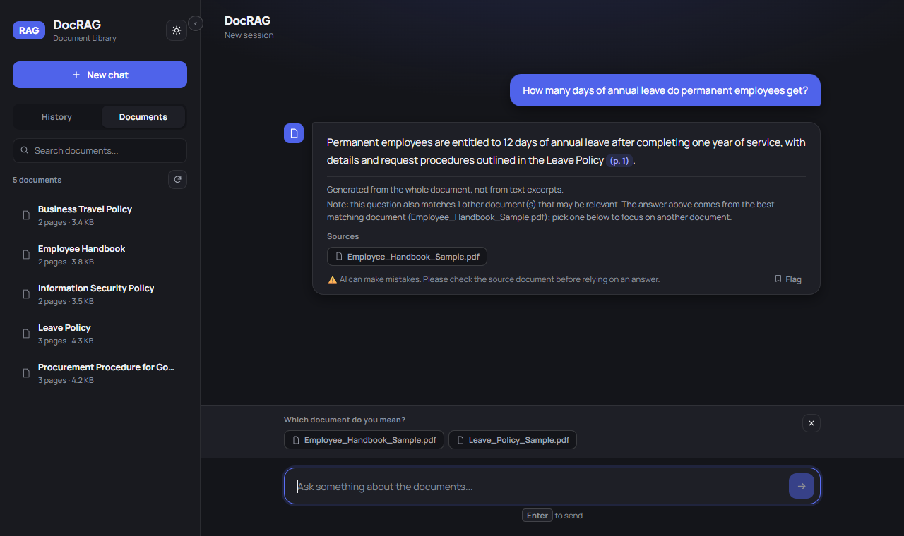
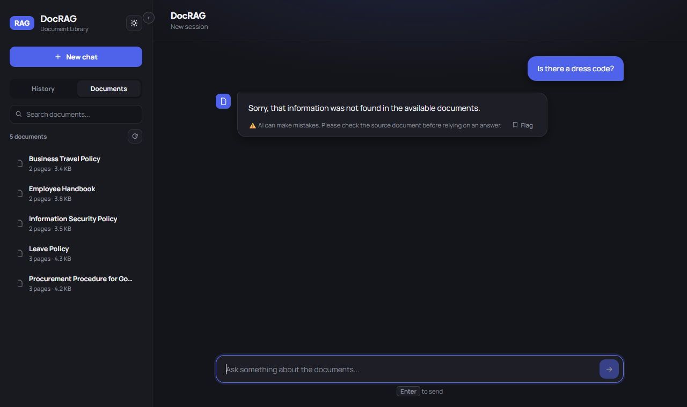
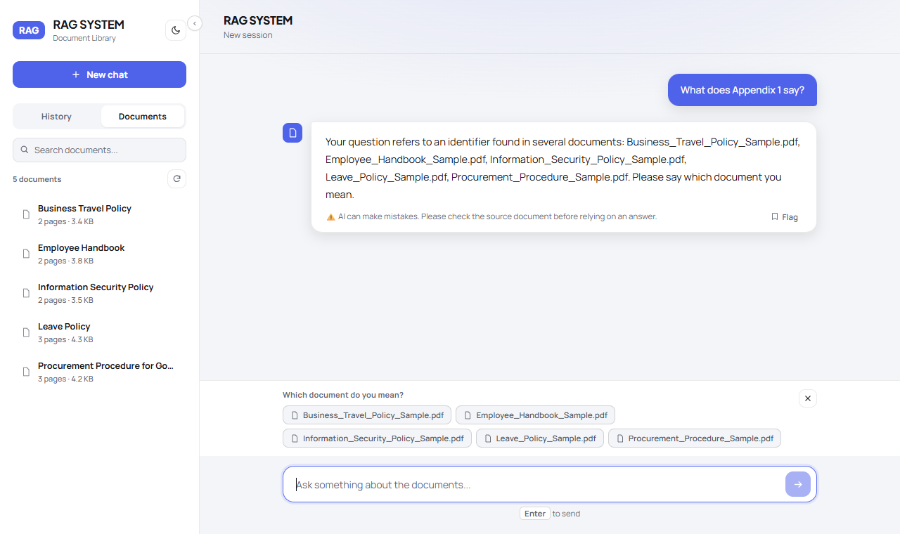

# DocRAG

[](https://github.com/riflifaizullah/docrag/actions/workflows/ci.yml)

## Demo

The screenshots below use the five fictional English sample documents. The interface is in English, and answers follow the language of the question, so you can ask in Indonesian too.

**Answer with sources**



**A refusal when the documents do not cover the question**



**The document-choice prompt for an ambiguous question**



A local-first question answering system for PDF documents. Ask a question in plain language and get an answer with the source document and page, or an honest "not found" when the documents do not contain the answer.

Developed from a system I built during an AI engineering internship and rebuilt as a company-neutral, open-source version. It contains no company data, documents, names or branding, and it includes fictional sample documents in English and Indonesian so you can try it right away.

## At a glance

- **Grounded answers with page citations.** Each answer names its source documents and pages.
- **Refuses instead of guessing.** If nothing relevant is retrieved, you get a clear "not found".
- **Hybrid retrieval with reranking.** Vector and keyword search are merged, then a cross-encoder reranks the candidates.
- **Runs fully local.** The language model, embeddings and reranker all run on your own machine.


## What it does

- **Grounded answers with sources.** Every answer lists the documents it was built from, and the page can be opened in a side panel.
- **Refuses instead of guessing.** If no retrieved passage is relevant enough, the system says so without calling the language model.
- **Asks which document you mean.** A question like "what does Appendix 1 say?" that matches several documents returns a list to choose from, not a guess.
- **Flags unverified section numbers.** If an answer cites a section or appendix number that does not exist in the source document's headings, a note is added.
- **Answers in your language.** Ask in English or Indonesian and the answer, the refusals and the prompts follow.
- **Runs locally.** The language model runs through [Ollama](https://ollama.com), so document text never leaves the machine.
- **Keeps the index current.** A button in the sidebar re-indexes the documents folder and reports what was added, updated or removed.

## Languages

- **Interface:** English.
- **Answers:** written in the language of the question. The prompt, the answer and the system messages (refusals, "which document do you mean?") all follow it, and a question in one language about a document in the other works too.
- **Documents:** heading patterns for both languages are always active (Article, Section, Appendix, Chapter and Pasal, Lampiran, Bab, Ayat), so English and Indonesian documents can share one index.
- **Samples:** `samples/en` and `samples/id`, five documents each.
- **`DOCRAG_LANG`** (`en` by default) is the language used when a question's language is unclear.
- **Another language** needs one module in `backend/app/lang/` and an entry in its `SUPPORTED` list.

## Try it in four steps

```bash
pip install -r backend/requirements.txt          # 1. backend dependencies
ollama pull qwen3.5:9b                           # 2. local language model
python scripts/load_samples.py                   # 3. load the English samples and build the index (use id for Indonesian)
cd dotnet/RagSystemWeb && dotnet run             # 4. start the website, then open http://localhost:5080
```

You need Python 3.10+, the .NET 8 SDK and Ollama, and a GPU with about 8 GB of memory is recommended. The full guide, example questions and troubleshooting are in [docs/GETTING_STARTED.md](docs/GETTING_STARTED.md).

## How a question is answered


A question ends in one of four ways: an answer, a refusal, a request to choose a document, or a deterministic list.

## How documents are indexed

Indexing runs when you sync, not on every question.

1. **Read.** Each PDF's text is extracted page by page. Scanned pages fall back to OCR, and pages that are mostly diagrams can be described by a vision model.
2. **Find the structure.** Headings such as Article, Appendix and Chapter (or Pasal, Lampiran and Bab) are detected, so a passage never cuts a clause in half.
3. **Chunk.** The text is split along those headings into passages of about 1000 characters, each keeping its document and page number.
4. **Store.** Each passage becomes a vector in ChromaDB. Headings and file details go into SQLite, and a keyword index is built alongside.

### Keeping the index current

Documents are read from one folder, `backend/data/corpus/`. Click the re-index button in the sidebar (or call `POST /sync`) and DocRAG compares each file's content hash:

- **New** files are indexed.
- **Changed** files are re-chunked.
- **Deleted** files are removed.

The button then reports the counts. The folder is also checked automatically every 15 minutes, and unchanged files are skipped, so a sync is fast.

### Using it with your own documents

DocRAG reads PDFs from a folder. It has no built-in connector to a database or document system, so connecting your own source means getting the files into that folder.

- **Simplest:** export or copy your documents into the corpus folder on a schedule, then call `POST /sync`.
- **Deeper:** `backend/app/sync_documents.py` is the one place that lists and reads files, which makes it the natural place for a custom connector.
- **Settings:** chunk size, the relevance thresholds and the models are in `backend/app/config.py`.
- **Before you share it:** the backend has no sign-in and listens on localhost only, so a shared deployment needs authentication and access rules in front of it.

## How retrieval works


1. **Structure-aware chunking.** PDFs are split along their headings, keeping page numbers, with OCR as a fallback for scanned pages and an optional vision model for diagram pages.
2. **Hybrid search.** Dense vector search (multilingual MiniLM embeddings in ChromaDB) and BM25 keyword search are merged with reciprocal rank fusion. Keyword search matters for exact identifiers such as clause numbers.
3. **Reranking.** A cross-encoder rescores the top 100 candidates and keeps the best 8.
4. **Relevance gate.** The question is refused if neither the raw similarity nor the rerank score clears its threshold.
5. **Generation.** The local model answers using only the retrieved passages.

More diagrams (sequence of a request, ingestion, data model, module map) and a walkthrough of each are in [docs/ARCHITECTURE.md](docs/ARCHITECTURE.md).

## How it was tested

An earlier version of this pipeline was run on a private collection of more than 1,000
real-world PDF documents (roughly 19,000 pages, mostly Indonesian, mixed layouts).
That data cannot be shared, so these results cannot be reproduced from this repository.
They are included only to show how the design behaved at scale.

In the final run, 820 questions were scored as answer-or-refuse decisions: 700 had an
answer in the documents and 120 were off-topic or made up and should have been refused.

- **Precision 99.2 percent:** of the 617 questions the system answered, 612 should have
  been answered. This measures whether it answered the right questions, not whether
  each answer was correct, and the refusal set was easy to spot.
- **Recall 87.4 percent:** of the 700 answerable questions, 612 were answered. The 88
  misses were refusals, and most of those were cases where the section had no real text
  to quote. This number was not recalculated to account for that.
- **Stability:** all 1,000 questions completed with no runtime errors.

Known limits: the system prefers precision to recall, so it sometimes says "not found"
when an answer exists. Finding the exact page is its weakest step, and searching across
many documents for a topic is less precise than asking about one document. Answering is
slow on a local model.

The English and Indonesian sample documents in this repository are small and are
the only data this exact code has been checked against.

## Documentation

| Page | Contents |
|---|---|
| [docs/GETTING_STARTED.md](docs/GETTING_STARTED.md) | Setup, sample documents, example questions, troubleshooting |
| [docs/ARCHITECTURE.md](docs/ARCHITECTURE.md) | All diagrams explained, module map, settings, trade-offs |
| [docs/API.md](docs/API.md) | Endpoints with request and response shapes |

## Tech stack

| Part | Technology |
|---|---|
| Backend | Python, FastAPI |
| Vector store and metadata | ChromaDB, SQLite |
| Embeddings and rerank | sentence-transformers (multilingual MiniLM, cross-encoder) |
| Keyword search | rank-bm25 |
| Language model | Ollama (`qwen3.5:9b`), vision model `qwen2.5vl:7b` for diagram pages |
| PDF and OCR | pdfplumber, Tesseract, OpenCV |
| Website | .NET 8, Blazor Server |

## Tests

```bash
cd backend && python -m pytest                 # unit tests, no Ollama needed
cd dotnet && dotnet test RagSystemWeb.Tests    # website tests with a fake backend client
```

The website talks to the backend through an `IApiClient` interface, so its chat state logic is unit tested with a hand-written fake instead of a live server. Both suites run on every push in GitHub Actions.

## Design decisions

- **Hybrid search over vectors alone.** Embeddings can rank a clause with the wrong number above the right one, because repetitive legal text looks alike. Keyword search catches the exact identifier.
- **A relevance gate before the model.** Refusing early is cheaper and safer than asking the model to decide, and it keeps unrelated questions from producing confident text.
- **Candidate pool size mattered more than the reranker.** In a test on a private document set, most wrong-page results never reached the reranker. Raising the candidate pool from 35 to 100 helped more than swapping in a larger reranker.
- **Lazy sessions.** A chat session is created only when the first message is sent, so opening the page never leaves empty sessions behind.
- **Local model by default.** Documents may be sensitive, so nothing is sent to an external API.

## Limitations

- The model and reranker need a reasonably capable machine, and a full answer takes a few seconds to about half a minute locally.
- The relevance gate was tuned on a larger document set. On a very small set such as the bundled samples, a vaguely worded question can be refused even when the right document ranks first. The thresholds are in `backend/app/config.py`.
- Heading patterns, question splitting and refusal phrases cover English and Indonesian only. The answer language is guessed from common words, so a very short or mixed-language question falls back to `DOCRAG_LANG`.
- Retrieval depends on vocabulary. A question that says "hotel" can miss a passage that only says "accommodation", because the reranker scores the two words as unrelated.
- No public evaluation results are included. The evaluation harness used during development ran on a private document set and is not part of this repository, so this README reports no accuracy numbers.
- It is not deployed publicly.

## Security notes

DocRAG is built to run on one machine for one user.

- The backend listens on `127.0.0.1` only and has no sign-in. Do not expose port 8000. Set `DOCRAG_API_HOST` only if you put authentication in front of it.
- A request whose `Host` header is not `localhost` or `127.0.0.1` is rejected, which blocks DNS rebinding from a web page. `DOCRAG_ALLOWED_HOSTS` changes the list.
- Files are served only if they are indexed documents, so a path such as `../config.py` returns 404. A question is limited to 4000 characters.
- Answers are HTML-encoded before they are shown, and model output is never executed.
- Document text is passed to the model, so a document can try to steer an answer (prompt injection). Index only documents you trust.
- Dependencies are pinned and checked with `pip-audit` and `dotnet list package --vulnerable`. A few advisories remain in packages that cannot move without changing the stored index or the Pydantic version (`chromadb`, `sentence-transformers`, `transformers`, `starlette`). The details are in [docs/ARCHITECTURE.md](docs/ARCHITECTURE.md).

## Need help?

DocRAG is free to use and change under the MIT license. If you want help connecting it to your own documents, tuning it, or running it inside your network, you can reach me on [LinkedIn](https://www.linkedin.com/in/riflifaizullah). Bugs and questions are welcome as [GitHub issues](https://github.com/riflifaizullah/docrag/issues).

## License

MIT. See [LICENSE](LICENSE).
