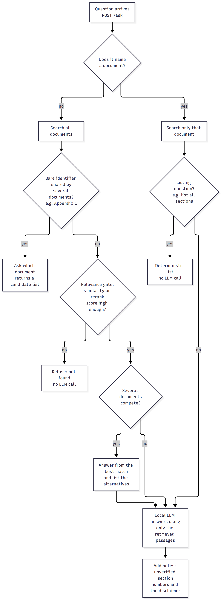
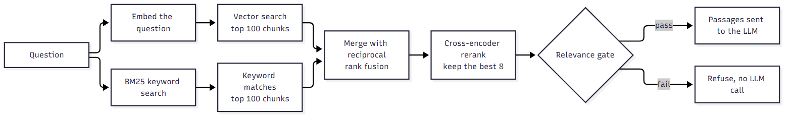

# DocRAG

[](https://github.com/riflifaizullah/docrag/actions/workflows/ci.yml)

A local-first question answering system for PDF documents. Ask a question in plain language and get an answer with the source document and page, or an honest "not found" when the documents do not contain the answer.

This is a company-neutral version of a system originally built during a AI engineering internship. It contains no company data, documents, names or branding. Five fictional sample documents are included so you can try it right away.


## What it does

- **Grounded answers with sources.** Every answer lists the documents it was built from, and the page can be opened in a side panel.
- **Refuses instead of guessing.** If no retrieved passage is relevant enough, the system says so without calling the language model.
- **Asks which document you mean.** A question like "what does Appendix 1 say?" that matches several documents returns a list to choose from, not a guess.
- **Flags unverified section numbers.** If an answer cites a section or appendix number that does not exist in the source document's headings, a note is added.
- **Runs locally.** The language model runs through [Ollama](https://ollama.com), so document text never leaves the machine.

## Try it in four steps

```bash
pip install -r backend/requirements.txt          # 1. backend dependencies
ollama pull qwen3.5:9b                           # 2. local language model
python scripts/load_samples.py                   # 3. load the sample documents and build the index
cd dotnet/RagSystemWeb && dotnet run             # 4. start the website, then open http://localhost:5080
```

You need Python 3.10+, the .NET 8 SDK and Ollama, and a GPU with about 8 GB of memory is recommended. The full guide, example questions and troubleshooting are in [docs/GETTING_STARTED.md](docs/GETTING_STARTED.md).

## How a question is answered



A question ends in one of four ways: an answer, a refusal, a request to choose a document, or a deterministic list.

## How retrieval works



1. **Structure-aware chunking.** PDFs are split along their headings, keeping page numbers, with OCR as a fallback for scanned pages and an optional vision model for diagram pages.
2. **Hybrid search.** Dense vector search (multilingual MiniLM embeddings in ChromaDB) and BM25 keyword search are merged with reciprocal rank fusion. Keyword search matters for exact identifiers such as clause numbers.
3. **Reranking.** A cross-encoder rescores the top 100 candidates and keeps the best 8.
4. **Relevance gate.** The question is refused if neither the raw similarity nor the rerank score clears its threshold.
5. **Generation.** The local model answers using only the retrieved passages.

More diagrams (sequence of a request, ingestion, data model, module map) and a walkthrough of each are in [docs/ARCHITECTURE.md](docs/ARCHITECTURE.md).

## Documentation

| Page | Contents |
|---|---|
| [docs/GETTING_STARTED.md](docs/GETTING_STARTED.md) | Setup, sample documents, example questions, troubleshooting |
| [docs/ARCHITECTURE.md](docs/ARCHITECTURE.md) | All diagrams explained, module map, settings, trade-offs |
| [docs/API.md](docs/API.md) | Endpoints with request and response shapes |

## Tech stack

| Part | Technology |
|---|---|
| Backend | Python, FastAPI |
| Vector store and metadata | ChromaDB, SQLite |
| Embeddings and rerank | sentence-transformers (multilingual MiniLM, cross-encoder) |
| Keyword search | rank-bm25 |
| Language model | Ollama (`qwen3.5:9b`), vision model `qwen2.5vl:7b` for diagram pages |
| PDF and OCR | pdfplumber, Tesseract, OpenCV |
| Website | .NET 8, Blazor Server |

## Tests

```bash
cd backend && python -m pytest                 # unit tests, no Ollama needed
cd dotnet && dotnet test RagSystemWeb.Tests    # website tests with a fake backend client
```

The website talks to the backend through an `IApiClient` interface, so its chat state logic is unit tested with a hand-written fake instead of a live server. Both suites run on every push in GitHub Actions.

## Design decisions

- **Hybrid search over vectors alone.** Embeddings can rank a clause with the wrong number above the right one, because repetitive legal text looks alike. Keyword search catches the exact identifier.
- **A relevance gate before the model.** Refusing early is cheaper and safer than asking the model to decide, and it keeps unrelated questions from producing confident text.
- **Candidate pool size mattered more than the reranker.** In a test on a private document set, most wrong-page results never reached the reranker. Raising the candidate pool from 35 to 100 helped more than swapping in a larger reranker.
- **Lazy sessions.** A chat session is created only when the first message is sent, so opening the page never leaves empty sessions behind.
- **Local model by default.** Documents may be sensitive, so nothing is sent to an external API.

## Limitations

- The model and reranker need a reasonably capable machine, and a full answer takes a few seconds to about half a minute locally.
- The relevance gate was tuned on a larger document set. On a very small set such as the bundled samples, a vaguely worded question can be refused even when the right document ranks first. The thresholds are in `backend/app/config.py`.
- The heuristics are tuned for Indonesian documents, and the interface text and answer prompt are in Indonesian.
- No public evaluation results are included. The evaluation harness used during development ran on a private document set and is not part of this repository, so this README reports no accuracy numbers.
- It is not deployed publicly.
