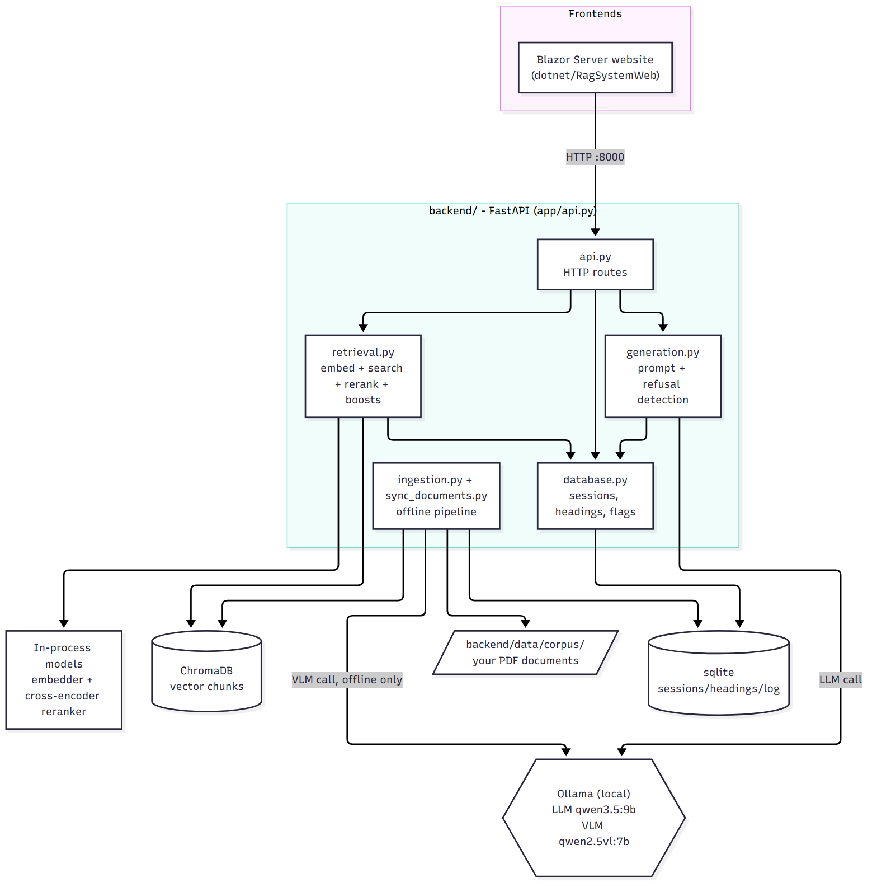
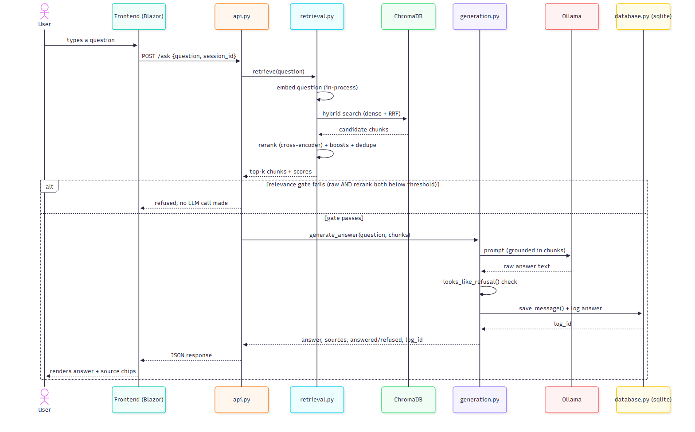

# DocRAG
n[](https://github.com/riflifaizullah/docrag/actions/workflows/ci.yml)

A local-first question answering system for PDF documents. Ask a question in plain language and get an answer with the source document and page, or an honest "not found" when the documents do not contain the answer.

This is a company-neutral version of a system originally built during a software engineering internship. It contains no company data, documents, names or branding.



## What it does

- **Grounded answers with sources.** Every answer lists the documents it was built from, and the page can be opened in a side panel.
- **Refuses instead of guessing.** If no retrieved passage is relevant enough, the system says so without calling the language model.
- **Asks which document you mean.** A question like "what does Appendix 12 say?" that matches several documents returns a list to choose from, not a guess.
- **Flags unverified section numbers.** If an answer cites a section or appendix number that does not exist in the source document's headings, a note is added.
- **Runs locally.** The language model runs through [Ollama](https://ollama.com), so document text never leaves the machine.

## How retrieval works

1. **Structure-aware chunking.** PDFs are split along their headings, keeping page numbers, with OCR as a fallback for scanned pages and an optional vision model for diagram pages.
2. **Hybrid search.** Dense vector search (multilingual MiniLM embeddings in ChromaDB) and BM25 keyword search are merged with reciprocal rank fusion. Keyword search matters for exact identifiers such as clause numbers.
3. **Reranking.** A cross-encoder rescores the top 100 candidates and keeps the best 8.
4. **Relevance gate.** The question is refused if neither the raw similarity nor the rerank score clears its threshold.
5. **Generation.** The local model answers using only the retrieved passages.



## Tech stack

| Part | Technology |
|---|---|
| Backend | Python, FastAPI |
| Vector store and metadata | ChromaDB, SQLite |
| Embeddings and rerank | sentence-transformers (multilingual MiniLM, cross-encoder) |
| Keyword search | rank-bm25 |
| Language model | Ollama (`qwen3.5:9b`), vision model `qwen2.5vl:7b` for diagram pages |
| PDF and OCR | pdfplumber, Tesseract, OpenCV |
| Website | .NET 8, Blazor Server |

## Run it

You need Python 3.10+, the .NET 8 SDK and Ollama. A GPU with about 8 GB of memory is recommended.

```bash
# 1. Backend dependencies
pip install -r backend/requirements.txt

# 2. Language model
ollama pull qwen3.5:9b

# 3. Add your own PDFs, then build the index
cp /path/to/your/pdfs/*.pdf backend/data/corpus/
cd backend && python -m app.sync_documents

# 4. Start the website (it also starts the backend)
cd ../dotnet/RagSystemWeb && dotnet run
```

Open http://localhost:5080. To run the backend alone: `cd backend && uvicorn app.api:app --port 8000`. If the website cannot find your Python, set the `DOCRAG_PYTHON` environment variable to the interpreter path.

OCR for scanned pages needs Tesseract and Poppler installed on the system. The vision model is optional (`ollama pull qwen2.5vl:7b`).

No documents are bundled with this repository. The interface text and the answer prompt are in Indonesian, and some retrieval heuristics are tuned for Indonesian legal and procedural documents (for example the words "Pasal" and "Lampiran").

## Tests

```bash
cd backend && python -m pytest     # 49 unit tests
cd dotnet && dotnet test RagSystemWeb.Tests
```

The website talks to the backend through an `IApiClient` interface, so its chat state logic is unit tested with a hand-written fake instead of a live server.

## API

| Endpoint | Purpose |
|---|---|
| `POST /ask` | Ask one or more questions in a session |
| `GET /sources`, `GET /documents` | List indexed documents |
| `GET /documents/{file}/download`, `/preview`, `/chunks` | Open a PDF, a page preview, or its chunks |
| `POST /sync` | Pick up new, changed and deleted files |
| `POST /sessions`, `GET /sessions`, `GET /sessions/{id}/history` | Chat sessions |
| `POST /flag/{log_id}`, `GET /export_flags` | Flag a bad answer and export flags |
| `GET /health`, `GET /monitor` | Health check and a small status page |

## Design decisions

- **Hybrid search over vectors alone.** Embeddings can rank a clause with the wrong number above the right one, because repetitive legal text looks alike. Keyword search catches the exact identifier.
- **A relevance gate before the model.** Refusing early is cheaper and safer than asking the model to decide, and it keeps unrelated questions from producing confident text.
- **Candidate pool size mattered more than the reranker.** In a test on a private document set, most wrong-page results never reached the reranker. Raising the candidate pool from 35 to 100 helped more than swapping in a larger reranker.
- **Lazy sessions.** A chat session is created only when the first message is sent, so opening the page never leaves empty sessions behind.
- **Local model by default.** Documents may be sensitive, so nothing is sent to an external API.

## Limitations

- The model and reranker need a reasonably capable machine, and full answers take a few seconds to about half a minute locally.
- The heuristics are tuned for Indonesian documents, and the interface text is Indonesian.
- No public sample documents or public evaluation results are included yet. The evaluation harness used during development ran on a private document set and is not part of this repository, so this README reports no accuracy numbers.
- It is not deployed publicly.
