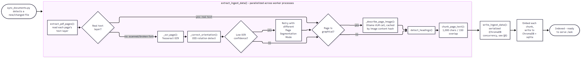
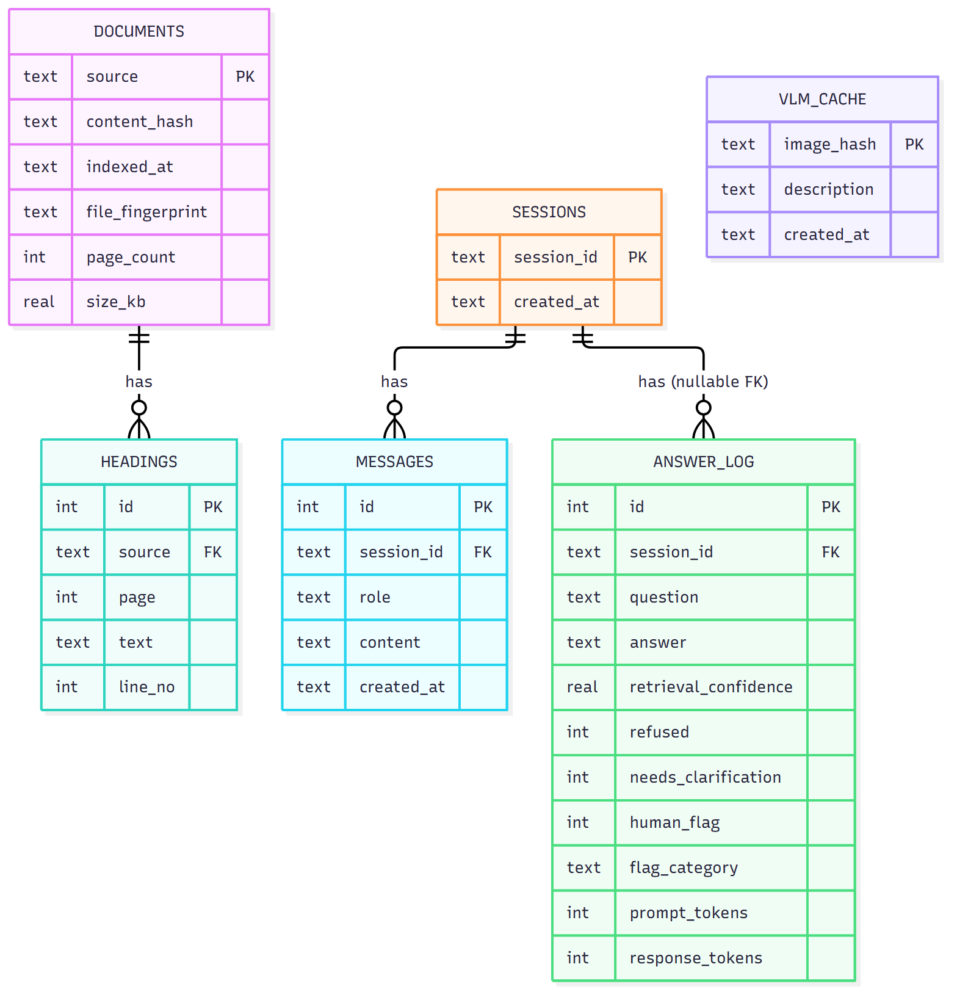
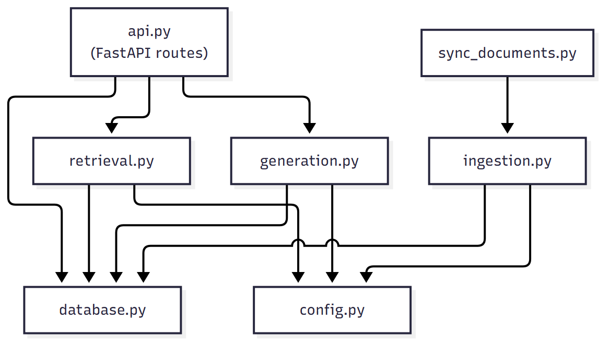

# Architecture

DocRAG answers questions about a folder of PDFs. This page explains how the parts fit together, using the diagrams in `diagrams/`. The diagram sources are Mermaid files (`.mmd`) next to the images, so they can be edited and re-rendered.

## 1. The big picture

- The **website** (Blazor Server) is a thin client. It only talks to the backend over HTTP on port 8000.
- The **backend** (FastAPI) holds all the logic. `api.py` exposes the routes, `retrieval.py` finds passages, `generation.py` builds the prompt and checks the answer, `database.py` stores sessions and headings, and `ingestion.py` plus `sync_documents.py` turn PDFs into searchable chunks.
- **ChromaDB** stores the text chunks as vectors. **SQLite** stores sessions, headings and an answer log.
- **Ollama** runs the language model locally. The embedding model and the reranker run inside the backend process.

Because the website only uses the HTTP API, any other client can replace it without touching the backend.

## 2. What happens when you ask a question

The question goes to `POST /ask`. The backend retrieves candidate passages, reranks them, and applies a relevance gate. If the gate fails, the answer is a refusal and no language model call is made. If it passes, the model writes an answer from the retrieved passages only, the backend checks the result, saves it, and returns the answer with its sources.

## 3. How an answer is decided

A question can end in one of four ways: a normal answer, a refusal, a request to choose a document, or a deterministic list. This diagram is a simplified view of `generate_answer()` in `generation.py`.

- **Refusal:** nothing retrieved was relevant enough, so the system says it cannot find the answer instead of guessing.
- **Choose a document:** a bare identifier such as "Appendix 1" exists in several documents, so the system returns the candidates and waits for the user to pick one.
- **Listing:** questions like "list all sections" are answered directly from the stored headings, with no model call.

## 4. Retrieval pipeline

1. **Dense search** finds chunks with a similar meaning, using multilingual MiniLM embeddings.
2. **BM25 keyword search** finds chunks that contain the exact words, which matters for identifiers such as clause numbers. Embeddings alone can rank a clause with the wrong number above the right one, because legal text is repetitive.
3. **Reciprocal rank fusion** merges the two ranked lists.
4. A **cross-encoder** scores each (question, chunk) pair together and keeps the best 8 of the top 100 candidates.
5. The **relevance gate** passes only if the raw similarity or the rerank score is high enough.

In a test on a private document set, most wrong-page results never reached the reranker, so raising the candidate pool from 35 to 100 helped more than swapping in a larger reranker.

## 5. Ingestion

Ingestion runs offline (`python -m app.sync_documents`). It reads each page's text layer and falls back to OCR when a page has no usable text. It detects headings (lines such as "Bab", "Pasal" and "Lampiran", and numbered sections), splits the text along those headings while keeping page numbers, embeds the chunks, and writes them to ChromaDB and SQLite. Files are tracked by content hash, so a sync only reprocesses new or changed files and removes deleted ones.

## 6. Data model

SQLite holds the metadata: documents, detected headings, chat sessions and messages, an answer log (which also records the flags users raise on answers), and a cache of vision-model page descriptions. ChromaDB holds only the chunk text and vectors.

## 7. Module map

| File | Responsibility |
|---|---|
| `api.py` | HTTP routes and the small status page |
| `retrieval.py` | Embedding, hybrid search, reranking, document name matching, ambiguity detection |
| `generation.py` | Prompt, model call, refusal detection, section number checks, multi-question handling |
| `database.py` | SQLite access: sessions, headings, answer log, flags |
| `ingestion.py` | PDF parsing, OCR fallback, heading detection, chunking |
| `sync_documents.py` | Detects new, changed and deleted files and keeps the index in step |
| `config.py` | All tunable values in one place |

## 8. Settings worth knowing

All in `backend/app/config.py`.

| Setting | Default | Effect |
|---|---|---|
| `OLLAMA_MODEL` | `qwen3.5:9b` | The language model used for answers |
| `EMBEDDING_MODEL` | `paraphrase-multilingual-MiniLM-L12-v2` | Embeddings for vector search |
| `RERANK_MODEL` | `cross-encoder/mmarco-mMiniLMv2-L12-H384-v1` | Cross-encoder reranker (about 470 MB) |
| `TOP_K` | 8 | Passages sent to the model |
| `RERANK_CANDIDATE_K`, `BM25_CANDIDATE_K` | 100 | Candidates considered before reranking |
| `RELEVANCE_MIN_SCORE`, `RELEVANCE_MIN_RERANK_SCORE` | 0.62, 0.0 | Relevance gate thresholds |
| `OLLAMA_CONTEXT_TOKENS` | 16384 | Context size used for prompts |

## 9. Trade-offs and known limits

- **The gate was tuned on a different, larger document set.** On a very small set of documents, a vague question can be refused even though the right document ranks first. Lowering the two gate thresholds makes it more willing to answer, at the cost of more wrong answers to unrelated questions.
- **Heuristics lean towards Indonesian.** Heading patterns, the answer prompt and the interface text are in Indonesian.
- **Local model means local hardware.** A full answer takes seconds to about half a minute on a laptop GPU.
- **No accuracy numbers are published.** The evaluation harness used during development ran on private documents and is not part of this repository.
